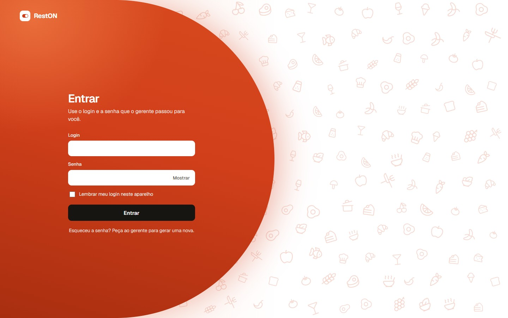

# RestON

Sistema web para gerenciar um restaurante: mesas, reservas, comandas, cozinha e bar, caixa, cardápio, estoque e relatórios. Os pedidos aparecem na cozinha em tempo real.

<p align="center">
  
</p>

## Tecnologias

- Backend: Java 21 e Spring Boot (Maven), com Spring Security, JPA e Flyway
- Frontend: Angular 21
- Banco de dados: PostgreSQL 17, rodando no Docker
- Tempo real: Server-Sent Events (SSE)
- Testes: JUnit com Testcontainers, Vitest e Playwright

Os requisitos do sistema estão em [REQUISITOS.md](REQUISITOS.md) e as bibliotecas em [requirements.txt](requirements.txt).

## Perfis

Cada funcionário tem um perfil e só vê as telas dele:

- **Administrador:** tudo, inclusive a auditoria
- **Gerente:** visão geral, relatórios, mesas, reservas, comandas, cozinha, caixa, cardápio, estoque e equipe
- **Garçom:** mesas, reservas e comandas
- **Caixa:** comandas e caixa
- **Cozinha:** quadro de pedidos da cozinha
- **Bartender:** quadro de pedidos do bar

## Como rodar

Você precisa ter instalados: Java 21, Node.js 24 (com npm), Docker Desktop e Git. O Maven não precisa, porque o projeto traz o `mvnw`.

Abra três terminais.

**1. Banco de dados** (na pasta do projeto)

```bash
docker compose up -d
```

**2. API** (na pasta `backend`)

```bash
./mvnw spring-boot:run
```

No Windows (cmd ou PowerShell), use `mvnw.cmd spring-boot:run`. A API sobe em http://localhost:8080 e o Flyway cria as tabelas sozinho.

**3. Frontend** (na pasta `frontend`)

```bash
npm install
npm start
```

Abra http://localhost:4200. Quando tudo estiver conectado, aparece "API online" no canto da tela.

Para desligar, pare a API e o Angular com `Ctrl+C` e rode `docker compose stop`. Evite `docker compose down -v`, porque apaga o banco.

## Primeiro acesso

Na primeira vez que a API sobe com o banco vazio, ela cria o usuário `admin` com uma senha provisória, que aparece uma única vez no log da API (procure por "senha provisória"). No primeiro login o sistema pede para trocar a senha. Depois, o admin cadastra os outros funcionários na tela Equipe.

As variáveis de ambiente estão no `.env.example`.

## Modo demonstração

Serve para apresentar o sistema já preenchido, e fica desligado por padrão. Com o banco vazio, suba a API assim:

```bash
RESTON_DEMO_ATIVO=true ./mvnw spring-boot:run
```

No PowerShell: `$env:RESTON_DEMO_ATIVO="true"; .\mvnw.cmd spring-boot:run`.

Ele cria um funcionário de cada perfil (`gerente`, `garcom1`, `garcom2`, `caixa`, `cozinha` e `bartender`), mesas, cardápio com fotos, estoque, reservas, vendas dos últimos dias e algumas mesas ocupadas. A senha deles fica no log da API e na constante `SENHA_DEMO`, em `backend/src/main/java/br/edu/reston/demo/DadosDemo.java`. Não use esse modo em produção.

## Testes

```bash
cd backend && ./mvnw test      # precisa do Docker ligado
cd frontend && npm test
cd frontend && npm run e2e     # no navegador, precisa do modo demonstração
```

## Estrutura

```
backend/     API Spring Boot, um pacote por assunto (auth, mesa, reserva, cardapio, comanda, pedido, caixa...)
frontend/    Angular (src/app/paginas tem uma pasta por tela)
docker-compose.yml   banco PostgreSQL
REQUISITOS.md        requisitos do sistema
requirements.txt     programas e bibliotecas usados
```
